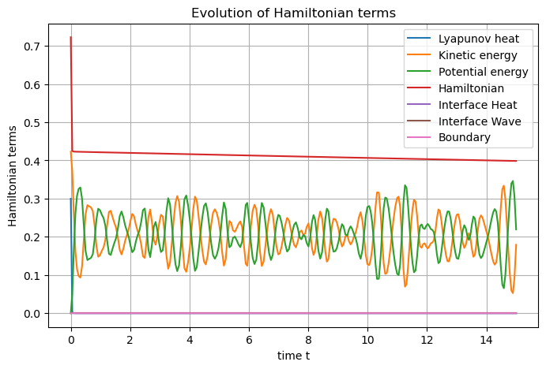
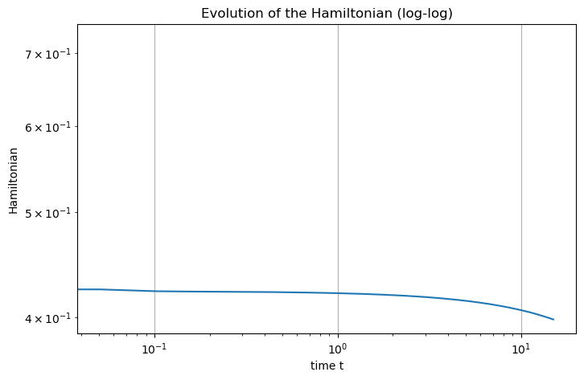

Heat wave coupling
==================

.. _Heat_Wave_2D:

.. automodule:: examples.heat_wave
   :members:
   :undoc-members:
   :show-inheritance:

Setting
-------

It is assumed that the `2D wave
equation <https://g-haine.github.io/scrimp/examples/wave.html>`_, the
`2D wave equation in co-energy
formulation <https://g-haine.github.io/scrimp/examples/wave_coenergy.html>`_
and the `2D heat
equation <https://g-haine.github.io/scrimp/examples/heat.html>`_ have
already been studied.

The objective of this example is to deal with interconnection in the
sense of port-Hamiltonian systems.

We are interested in the coupled heat-wave system which can be
formulated as follows: let :math:`\Omega := \Omega_W \cup \Omega_H` be a
bounded domain in :math:`\mathbb{R}^2` such that
:math:`\Omega_W \cap \Omega_H = \emptyset`, we denote
:math:`\Gamma_I := \partial\Omega_W \cap \partial\Omega_H` the interface
between the two domains, and
:math:`\Gamma_W := \partial\Omega_W \setminus \Gamma_I` and
:math:`\Gamma_H := \partial\Omega_H \setminus \Gamma_I`. The system of
equations reads

.. math::

       \left\lbrace
       \begin{array}{rcl}
       \partial_t T(t,x) &=& {\rm div}\left( {\rm grad}\left( T(t,x) \right)\right), \quad \forall t\ge0, x \in \Omega_H, \\
       \partial_{tt}^2 w(t,x) &=& {\rm div}\left( {\rm grad}\left( w(t,x) \right)\right), \quad \forall t\ge0, x \in \Omega_W, \\
       T(t,s) &=& 0, \quad \forall t\ge0, s \in \Gamma_H, \\
       w(t,s) &=& 0, \quad \forall t\ge0, s \in \Gamma_W, \\
       \end{array}
       \right.

together with the transmission conditions across the interface

.. math::

       \left\lbrace
       \begin{array}{rcl}
       T(t,s) &=& \partial_t w(t,s), \quad \forall t\ge0, s \in \Gamma_I, \\
       \partial_{n_H} T(t,s) &=& - \partial_{n_W} w(t,s), \quad \forall t\ge0, s \in \Gamma_I, \\
       \end{array}
       \right.

where :math:`n_H` is the outward normal to :math:`\Omega_H` and
:math:`n_W` is the outward normal to :math:`\Omega_W`. Hence,
:math:`n_H = -n_W` on :math:`\Gamma_I`.

Port-Hamiltonian framework
--------------------------

-  The heat equation

The heat equation reads

.. math::

       \begin{pmatrix} \partial_t T \\ e_q \end{pmatrix} = 
       \begin{bmatrix} 0 & - {\rm div} \\ - {\rm grad} & 0 \end{bmatrix} 
       \begin{pmatrix} T \\ e_Q \end{pmatrix},

together with the boundary ports

.. math::

       \left\lbrace
       \begin{array}{rcl}
       u^I_H &=& T, \quad \Gamma_I, \\
       y^I_H &=& e_Q \cdot n_H, \quad \Gamma_I,
       \end{array}
       \right.

and

.. math::

       \left\lbrace
       \begin{array}{rcl}
       u_H &=& T, \quad \Gamma_H, \\
       y_H &=& e_Q \cdot n_H, \quad \Gamma_H.
       \end{array}
       \right.

-  The wave equation

The Dirichlet boundary condition has to be relaxed by
:math:`\partial_t w = 0` to fit the port-Hamiltonian framework.
Providing this adaptation and the notation :math:`p := \partial_t w` and
:math:`q := {\rm grad}\left(w\right)`, the wave equation reads

.. math::

       \begin{pmatrix} \partial_t q \\ \partial_t p \end{pmatrix} = 
       \begin{bmatrix} 0 & {\rm grad} \\ {\rm div} & 0 \end{bmatrix} 
       \begin{pmatrix} q \\ p \end{pmatrix},

together with the boundary ports

.. math::

       \left\lbrace
       \begin{array}{rcl}
       u^I_W &=& q \cdot n_W, \quad \Gamma_I, \\
       y^I_W &=& p, \quad \Gamma_I,
       \end{array}
       \right.

and

.. math::

       \left\lbrace
       \begin{array}{rcl}
       u_W &=& q \cdot n_W, \quad \Gamma_H, \\
       y_W &=& p, \quad \Gamma_H.
       \end{array}
       \right.

-  The interconnection

The transmission condition at the interface may be recast as a
power-preserving interconnection. It can be either a **gyrator** or a
**tranformer** interconnection, depending on the chosen causality for
each system. We the above choices, we have a **gyrator
interconnection**, indeed, one has

.. math::

       u^I_H = y^I_w, \qquad u^I_W = y^I_H.

.. note:: Automatic assembly of conforming interfaces (v1.3.0)

   For this ``Concentric`` mesh, SCRIMP automatically resolves the
   logical interface region ``10`` into the two adjacent sets of
   facets and assembles each normal-dependent weak term on its
   correct subdomain side, using that side's outward normal. This
   is the default on the v1.3.0 preparation branch. The physical
   gyrator relations ``U_T = Y_w`` and ``U_w = Y_T`` remain
   part of the *model*, not something inferred from mesh topology.
   Unsupported or ambiguous conforming interfaces fail explicitly.
   See the `interface assembly and MPI production policy
   <https://github.com/g-haine/scrimp/blob/release/1.3.0-preparation/docs/V130_INTERFACE_PV_PRODUCTION_DECISION_20261124.md>`_
   for the scope, geometric orientation and native qualification.

Structure-preserving discretization
-----------------------------------

-  The heat equation

We use the div-div formulation already presented in the `2D heat
equation <https://g-haine.github.io/scrimp/examples/heat.html>`_
example, *i.e.* we obtain the following system

.. math::

       \underbrace{\begin{bmatrix}
       M_T & 0 & 0 & 0 \\
       0 & M_Q & 0 & 0 \\
       0 & 0 & M^I_H & 0 \\
       0 & 0 & 0 & M_H
       \end{bmatrix}}_{= M}
       \begin{pmatrix}
       \frac{\rm d}{{\rm d}t} \underline{T}(t) \\
       \underline{e_Q}(t) \\
       -\underline{y^I_H}(t) \\
       -\underline{y_H}(t)
       \end{pmatrix}
       =
       \underbrace{\begin{bmatrix}
       0 & D & 0 & 0 \\
       -D^\top & 0 & B^I_H & B_H \\
       0 & -(B^I_H)^\top & 0 & 0 \\
       0 & -(B_H)^\top & 0 & 0
       \end{bmatrix}}_{= J}
       \begin{pmatrix}
       \underline{T}(t) \\
       \underline{e_Q}(t) \\
       \underline{u^I_H}(t) \\
       \underline{u_H}(t)
       \end{pmatrix},

-  The wave equation

We use the grad-grad formulation already presented in the `2D wave
equation <https://g-haine.github.io/scrimp/examples/wave.html>`_
example, *i.e.* we obtain the following system

.. math::

       \underbrace{\begin{bmatrix}
       M_q & 0 & 0 & 0 \\
       0 & M_p & 0 & 0 \\
       0 & 0 & M^I_W & 0 \\
       0 & 0 & 0 & M_W
       \end{bmatrix}}_{= M}
       \begin{pmatrix}
       \frac{\rm d}{{\rm d}t} \underline{q}(t) \\
       \frac{\rm d}{{\rm d}t} \underline{p}(t) \\
       -\underline{y^I_W}(t) \\
       \underline{u_W}(t)
       \end{pmatrix}
       =
       \underbrace{\begin{bmatrix}
       0 & D & 0 & 0 \\
       -D^\top & 0 & B^I_W & -B_W^\top \\
       0 & -(B^I_W)^\top & 0 & 0 \\
       0 & B_W & 0 & 0
       \end{bmatrix}}_{= J}
       \begin{pmatrix}
       \underline{q}(t) \\
       \underline{p}(t) \\
       \underline{u^I_W}(t) \\
       -\underline{y_W}(t)
       \end{pmatrix},

-  The gyrator interconnection

This condition is easy to implement, and leads to

.. math::

       M^I_H \underline{u^I_H}(t) = M^I_W \underline{y^I_W}(t), \qquad M^I_W \underline{u^I_W}(t) = M^I_H \underline{y^I_H}(t).

Simulation
----------

Let us start as usual, but using now the ``Concentric`` built-in
geometry.

.. code:: python

    # Import scrimp
    import scrimp as S
    
    # Init the distributed port-Hamiltonian system
    hw = S.DPHS("real")
    
    # Set the domain (using the built-in geometry `Concentric`)
    # Labels: Disk = 1, Annulus = 2, Interface = 10, Boundary = 20
    omega = S.Domain("Concentric", {"R": 1.0, "r": 0.6, "h": 0.1})
    
    # And add it to the dphs
    hw.set_domain(omega)

It is important to remember here one of the objective of this example:
to understand the ``region`` keyword.

For our study case, the heat equation will lie on a region
``heat_region``, while the wave equation will lie on another region
``wave_region``. And this has to be stated when defining the states and
co-states, and everytime an integral (either the *weak forms* or the
*Hamiltonian terms*) occurs.

.. code:: python

    # Define the states and costates, needs the heat and wave region's labels
    heat_region = 1
    wave_region = 2
    states = [
        S.State("T", "Temperature", "scalar-field", region=heat_region),
        S.State("p", "Velocity", "scalar-field", region=wave_region),
        S.State("q", "Stress", "vector-field", region=wave_region),
    ]
    # Use of the `substituted=True` keyword to get the co-energy formulation
    costates = [
        S.CoState("T", "Temperature", states[0], substituted=True),
        S.CoState("p", "Velocity", states[1], substituted=True),
        S.CoState("q", "Stress", states[2], substituted=True),
    ]
    
    # Add them to the dphs
    for state in states:
        hw.add_state(state)
    for costate in costates:
        hw.add_costate(costate)

The same is true for the resistive port for the heat equation.

.. code:: python

    # Define the algebraic port
    ports = [
        S.Port("Heat flux", "e_Q", "e_Q", "vector-field", substituted=True, region=heat_region),
    ]
    
    # Add it to the dphs
    for port in ports:
        hw.add_port(port)
    
    # Define the control ports
    control_ports = [
        S.Control_Port(
            "Interface Heat", 
            "U_T", 
            "Heat flux", 
            "Y_T", 
            "Temperature",
            "scalar-field",
            region=10, 
            position="effort"
        ),
        S.Control_Port(
            "Interface Wave", 
            "U_w", 
            "Velocity", 
            "Y_w", 
            "Velocity", 
            "scalar-field", 
            region=10, 
            position="effort"
        ),
        # This port will be either for the wave or the heat equation
        # It corresponds to the exterior circle of radius R
        S.Control_Port( 
            "Boundary", 
            "U_bnd", 
            "0", 
            "Y_bnd", 
            ".", 
            "scalar-field", 
            region=20, 
            position="flow"
        ),
    ]
    
    # Add it to the dphs
    for ctrl_port in control_ports:
        hw.add_control_port(ctrl_port)

For the FEM choices, see the previous examples.

.. code:: python

    # Define the Finite Elements Method of each port
    k = 1
    FEMs = [
        S.FEM("T", k, "DG"),
        S.FEM("Heat flux", k+1, "CG"),
        S.FEM("Interface Heat", k, "DG"),
        S.FEM("p", k+1, "CG"),
        S.FEM("q", k, "DG"),
        S.FEM("Interface Wave", k, "DG"),
        S.FEM("Boundary", k, "DG"),
    ]
    
    # Add them to the dphs
    for FEM in FEMs:
        hw.add_FEM(FEM)

The ``Brick`` object does not have an *optional* ``region`` keyword, it
is mandatory: more precisely, it requires a list of regions as third
argument.

.. code:: python

    # Define the pHs via `Brick` == non-zero block matrices == variational terms
    # Since we use co-energy formulation, constitutive relations are already taken into
    # account in the mass matrices M_q and M_p
    bricks = [
        # === Heat: div-div
        S.Brick("M_T", "T*Test_T", [heat_region], dt=True, position="flow"),
        S.Brick("M_Q", "e_Q.Test_e_Q", [heat_region], position="flow"),
        S.Brick("M_Y_T", "Y_T*Test_Y_T", [10], position="flow"),
    
        S.Brick("D_T", "-Div(e_Q)*Test_T", [heat_region], position="effort"),
        S.Brick("D_T^T", "T*Div(Test_e_Q)", [heat_region], position="effort"),
        S.Brick("B_T", "U_T*Test_e_Q.Normal", [10], position="effort"),
        S.Brick("B_T^T", "e_Q.Normal*Test_Y_T", [10], position="effort"),
    
        # === Wave: grad-grad
        S.Brick("M_p", "p*Test_p", [wave_region], dt=True, position="flow"),
        S.Brick("M_q", "q.Test_q", [wave_region], dt=True, position="flow"),
        S.Brick("M_Y_w", "Y_w*Test_Y_w", [10], position="flow"),
    
        S.Brick("D_w", "-q.Grad(Test_p)", [wave_region], position="effort"),
        S.Brick("-D_w^T", "Grad(p).Test_q", [wave_region], position="effort"),
        S.Brick("B_w", "U_w*Test_p", [10], position="effort"),
        S.Brick("B_w^T", "p*Test_Y_w", [10], position="effort"),
    ]
    # === Boundary depends on where is the heat equation / wave equation
    if wave_region==1:
        bricks.append(S.Brick("M_Y_bnd", "Y_bnd*Test_Y_bnd", [20], position="flow"))
        bricks.append(S.Brick("B_bnd", "U_bnd*Test_e_Q.Normal", [20], position="effort"))
        bricks.append(S.Brick("B_bnd^T", "e_Q.Normal*Test_Y_bnd", [20], position="effort"))
    else:
        bricks.append(S.Brick("M_Y_bnd", "U_bnd*Test_Y_bnd", [20], position="flow"))
        bricks.append(S.Brick("B_bnd", "Y_bnd*Test_p", [20], position="effort"))
        bricks.append(S.Brick("B_bnd^T", "p*Test_Y_bnd", [20], position="effort"))
    for brick in bricks:
        hw.add_brick(brick)

Finally, the **gyrator** interconnection is implemented as reciprocal
output feedback. In SCRIMP v1.3.0, the automatic conforming-interface
compiler uses the actual **outward normal of each owning subdomain**.
The two interface powers therefore cancel with the physical signs
:math:`-U_T Y_T + U_w Y_w=0`; no artificial common-normal sign flip
must be introduced. See the interface note above for the validated
scope and implementation reference.

.. code:: python

    # Set the controls
    # === Gyrator interconnection
    hw.set_control("Interface Heat", "Y_w") 
    # Each outward physical normal is handled automatically by SCRIMP.
    hw.set_control("Interface Wave", "Y_T")
    # === Dirichlet boundary condition
    hw.set_control("Boundary", "0.")
    
    # Set the initial data
    hw.set_initial_value("T", "5.*np.exp(-25*((x-0.6)*(x-0.6)+y*y))")
    hw.set_initial_value("p", "5.*np.exp(-25*((x-0.6)*(x-0.6)+y*y))")
    hw.set_initial_value("q", "[0.,0.]")

    # The projected Gaussian p is incompatible with the homogeneous
    # outer Dirichlet condition. Correct only its *initial FE data*
    # before the STRICT algebraic DAE initializer: the normal
    # heat_wave_eq() function does this automatically ("clamp").
    from scrimp.utils.fe_initialization import (
        enforce_zero_dirichlet_initial_values
    )
    if wave_region == 2:
        enforce_zero_dirichlet_initial_values(
            hw, "p", volume_region=wave_region, boundary_region=20,
            method="clamp"
        )

    # Physical Crank--Nicolson with strict DAE compatibility.
    hw.set_time_scheme(init_step_ts_type="algebraic",
                       ts_type="cn",
                       ts_adapt_type="none",
                       t_f=15.,
                       dt=0.005,
                       dt_save=0.05,
                       ksp_type="preonly",
                       pc_type="lu",
                       pc_factor_mat_solver_type="mumps",
                       )
    
    # Solve
    hw.solve()

We end with the Hamiltonian plot. The source model uses the true
GetFEM/PETSc energy, and the optional long-time run saves a
log-log view of positive-time, positive-energy samples, **without
assuming or fitting a decay exponent**. The earlier illustrations
below are historical; the figures emitted by the current
``examples/heat_wave.py`` are the reproducible v1.3.0 outputs.

.. code:: python

    ## Post-processing
    ## Set Hamiltonian's name
    hw.hamiltonian.set_name("Hamiltonian")
    # Define each Hamiltonian Term
    terms = [
        S.Term("Lyapunov heat", "0.5*T*T", [heat_region]),
        S.Term("Kinetic energy", "0.5*p*p", [wave_region]),
        S.Term("Potential energy", "0.5*q.q", [wave_region]),
    ]
    # Add them to the Hamiltonian
    for term in terms:
        hw.hamiltonian.add_term(term)
    
    # Plot the Hamiltonian and save the output
    hw.plot_Hamiltonian(save_figure=True, filename="Hamiltonian_Heat"+str(heat_region)+"_Wave"+str(wave_region)+"_2D.png")
    
    # Plot the Hamiltonian in log-log scale
    t = hw.solution["t"]
    Hamiltonian = hw.get_Hamiltonian()
    import matplotlib.pyplot as plt
    fig = plt.figure(figsize=[8, 5])
    ax = fig.add_subplot(111)
    import numpy as np
    t = np.asarray(t)
    Hamiltonian = np.asarray(Hamiltonian)
    valid = (t > 0.) & (Hamiltonian > 0.)
    ax.loglog(t[valid], Hamiltonian[valid])
    ax.grid(axis="both")
    ax.set_xlabel("time t")
    ax.set_ylabel("Hamiltonian")
    ax.set_title("Evolution of the Hamiltonian (log-log)")
    plt.show()

Long-time wave gallery exploration (v1.3.0)
-------------------------------------------

The canonical source now generates **its own**
long-time energy and wave-visualization files,
using real GetFEM/PETSc fields. For an annulus
containing the wave equation
(``heat_region=1``, ``wave_region=2``),
run the reproducible Docker showcase
**after** separately passing the strict
short-horizon physical CN gate:

.. code-block:: bash

   cd ~/Simulations/scrimp
   SCRIMP_DOCKER_NO_SUDO=1 \
   SCRIMP_V130_DAE_IMAGE=scrimp-mpi:v1.3.0-rc3 \
   bash scripts/run-v130-heat-wave-long-showcase.sh

The profile selected by default in this
*showcase* is an angular wave packet
``gallery_packet`` concentrated near the
outer annulus, with initial oscillation
``cos(14*theta)``. It is **not** a computed
waveguide/cavity eigenmode. To generate
the **original Gaussian** heat–wave case
over the same long horizon, use
``SCRIMP_V130_HW_SHOWCASE_PROFILE=gaussian``
with the command above.
In both cases, ``initial_wave_boundary="clamp"``
enforces the homogeneous Dirichlet
condition exactly on the filtered
exterior CG1 degrees of freedom, after
the real default L² projection.
``constrained_l2`` is the alternative
true GetFEM-mass minimizing correction
(MPI1 only). The strict algebraic
initializer is never relaxed.

The physical example automatically
writes in ``outputs/showcase/heat_wave_annulus``:

- ``heat_wave_H_long_loglog.png`` and
  ``.svg``, together with the native
  ``heat_wave_FE_H_long.npz`` numerical
  trajectory (zero time is excluded
  **only** from the log-log plot);
- four original FE ``p`` snapshots
  of the outer annulus and
  ``wave_annulus_long.gif`` using
  at most 48 genuine saved VTK frames,
  with a fixed scalar color scale;
- ``wave_outer_shell_kinetic_proxy.png``
  showing an approximate CG1
  kinetic-velocity fraction in
  the outer ring ``r>=0.82``;
- ``provenance.json`` with the
  exact selected GetFEM times,
  the initial profile, and explicit
  qualification limitations.

All original ``T``, ``p`` and
``q`` VTK/PVD time series are
retained for detailed ParaView
inspection. The **H(t)** curve is an
actual FE Hamiltonian quadrature;
the images show actual native
GetFEM fields at nodes.
The radial diagnostic samples **only
CG1 kinetic energy**, with a
centroid-based shell approximation.
It is **not** the full wave energy,
a modal eigenanalysis, or a
whispering-gallery proof. Such a
claim would additionally require
persistent near-boundary localization
and a mode/directional propagation
study. See
`the v1.3.0 Heat–Wave physical report
<https://github.com/g-haine/scrimp/blob/release/1.3.0-preparation/docs/V130_HEAT_WAVE_PHYSICAL_AUDIT.md>`_
for the distinct native qualification
and evidence.

Native qualification: MPI1/2 FE parity and full-length CN power
--------------------------------------------------------------

The short native Heat--Wave case has a
true physical **MUMPS MPI1 PASS**.
The existing 15-second Gaussian and
annular visualizations are also complete,
but their saved **0.05** time spacing
does not represent consecutive **0.005**
Crank--Nicolson steps. Therefore the
figures alone cannot certify the
**heat, wave and coupled energy-power
identities at every time step**.

An additional *independent* native pilot
tests this distinction, without changing
the governing model:

.. code-block:: bash

   cd ~/Simulations/scrimp
   git pull --ff-only
   SCRIMP_DOCKER_NO_SUDO=1 \
   SCRIMP_V130_DAE_IMAGE=scrimp-mpi:v1.3.0-rc3 \
   bash scripts/run-v130-heat-wave-mpi-long-physics.sh

Stage A compares **all 7,689 original FE
coefficients** and independently assembled
heat/wave/interface physical quadratures
between MUMPS MPI1 and MPI2 at each of
five original CN times. It requires
the two MPI2 ranks to agree exactly.
Only after stage A passes does stage B
run **3,000** genuine MUMPS MPI1 CN
steps through `t_f=15`,
**saving all 3,001 states** so that
each midpoint power is evaluated on the
*actual adjacent FE states*, not on
widely separated visualization snapshots.
The native code also tests the cumulative
energy-power balance. The default
Gaussian profile can be compared to
the separate 15-second visual archive;
the optional environment variable
`SCRIMP_V130_HW_LONG_PROFILE=gallery_packet`
tests the angular-packet physics
independently.

Only the new `physics_only=True`
output option suppresses PNG/PVD
writers during the MPI calculation:
the canonical PDE, FEM, boundary
clamp, strict DAE initializer, native
PETSc solve and GetFEM quadratures
remain unchanged. The ordinary
tutorial still creates all its
plots and ParaView output by default.
Every native run and failure gets a
complete evidence ZIP.

**Qualification completed 25 November 2026.**
The actual native source ``97c7606b``
(``scrimp-mpi:v1.3.0-rc3``,
MUMPS) has passed both phases:

.. list-table:: Strict native Heat--Wave acceptance
   :header-rows: 1
   :widths: 34 33 33

   * - Measurement
     - MPI1/MPI2, four CN steps
     - MPI1, 3,000 CN steps
   * - Original FE unknowns
     - 7,689
     - 7,689
   * - Accepted / saved states
     - 4 / 5 per rank
     - 3,000 / 3,001
   * - Maximum independent total CN step defect
     - ``9.61e-16`` (MPI2)
     - ``4.02e-15``
   * - Maximum separate heat CN defect
     - ``1.28e-15`` (MPI2)
     - ``1.38e-15``
   * - Maximum separate wave CN defect
     - ``8.40e-16`` (MPI2)
     - ``3.98e-15``
   * - Maximum cumulative energy-power defect
     - ``8.46e-16`` (MPI2)
     - ``5.70e-15``
   * - Maximum signed interface power
     - ``8.88e-16`` (MPI2)
     - ``3.11e-15``
   * - Qualification
     - **PASS**
     - **PASS**

All the actual FE coefficients,
heat/wave energies, correctly oriented
interface powers, genuine thermal
dissipation and cumulative Hamiltonian
balance pass. The two ranks of MPI2
have **exactly identical** stored
trajectories; the maximum MPI1/MPI2
full coefficient difference is
``2.23e-12``.

The earlier native run at source
``42116b58`` had converged all
3,000 PETSc steps but **omitted the
accepted state 2999** from the saved
trajectory due to a floating-time
comparison. That historical archive
correctly retains its FAIL status.
The generic output-only fixed-CN
monitor fix now stores **all 3,001
real accepted FE states**, with no
time interpolation or physical changes.
The corrected run at source
``97c7606b`` passes the strict
complete ``t_f=15`` heat,
wave and total CN power identities.
The exact native archive is
``v130-heat-wave-MPI2-longCN-97c7606b-7NBvjofW.zip``.

**Scope:** short MPI1/MPI2 FE and
physical CN parity, plus the Gaussian
**15-second full energy-power
identity in MPI1**, are qualified.
The long annular ``gallery_packet``
remains a separately verified native
visualization, not a modal eigenproof
or a full-horizon power acceptance.
MPI2 long time, parallel ParaView
writers, SuperLU_DIST, h/dt convergence
and spectral whispering-gallery
identification are separate objectives.
See the
`full Heat--Wave qualification report
<https://github.com/g-haine/scrimp/blob/release/1.3.0-preparation/docs/V130_HEAT_WAVE_PHYSICAL_AUDIT.md>`_
for exact acceptance criteria and
the archived evidence.

Native qualification and long-time observations (25 November 2026)
-------------------------------------------------------------------

The actual ``examples/heat_wave.py``
with Gaussian initial data and
``initial_wave_boundary="clamp"``
has **passed all ten true physical
Crank--Nicolson gates** using MUMPS
MPI1. The short reference run,
``dt=0.001`` and ``t_f=0.004``,
contains 7,689 FE unknowns. The
maximum internal-interface signed
power defect is ``8.88e-16``;
the maximum independent heat,
wave and total step energy-power
balance defects are respectively
``4.92e-15``, ``1.39e-15``
and ``5.46e-15``.
The original native archive is
``v130-heat-wave-physical-b9d56fcc-3FQ8lFlC.zip``,
source ``b9d56fccc18c1f9facacdd9b6c2645c4de25fc47``.

**The two full 15-second calculations also completed
natively**, with 301 real GetFEM Hamiltonian
states, 301 VTU snapshots for each
of the ``p,q,T`` fields, 4 real
annular-wave PNGs and a 48-frame GIF:

.. list-table:: Native long-run energy changes
   :header-rows: 1
   :widths: 30 25 25 20

   * - Original excitation
     - ``H(0)``
     - ``H(15)``
     - Relative decrease
   * - Historical Gaussian
     - ``0.7836421212``
     - ``0.0082683891``
     - **98.9449%**
   * - Annular gallery packet
     - ``0.4626440660``
     - ``0.3779415176``
     - **18.3084%**

The original long-showcase acceptance driver
erroneously attempted ``frame["file"]``
instead of ``frame.attrib["file"]``
when inspecting the complete
ParaView XML catalogs. Consequently
the original ZIP summaries truthfully
retain the historical
``FAIL_OR_UNQUALIFIED_LONG_HEAT_WAVE_SHOWCASE``
status **although both native
simulations exited successfully**.
The exact original archives have
been independently reviewed and all
their actual files and frame clocks
verified. The current code corrects
that XML access and provides
``scripts/verify-v130-heat-wave-long-archive.py``
to re-audit the original ZIPs
without recomputing the complete
time histories. The review records
the distinct status
``PASS_ARCHIVED_LONG_NATIVE_VISUALS_NOT_WG_MODE_PROOF``,
without modifying the original
archives or the earlier pilot report.

The optional angular packet shows
a larger **approximate concentration
of the kinetic-velocity proxy**
within the outer shell ``r>=0.82``:
about ``0.587`` on average over
48 snapshots, versus ``0.380``
for the original Gaussian. This is
interesting evidence for visually
exploring gallery-like localization,
but **does not establish** a
whispering-gallery eigenmode,
tangential traveling-wave direction,
a theoretical decay exponent, or
the full 15-second heat/wave
energy-power identity.

**Overall scope (updated 25 November 2026):**
the physical reference and strict
**MPI1/MPI2 four-step FE parity**
are **PASS**. The **full Gaussian
15-second heat/wave/total CN
power identity in MPI1** is also
**PASS**, measured on each of the
3,000 genuine CN intervals.
The two long native visualization
datasets remain complete and
independently audited.
The **native 15-second MPI2** per-step
energy-power and oriented-interface
checks subsequently passed as well,
but full MPI1/MPI2 coefficient parity
failed the original pointwise gate.
Parallel VTK output, SuperLU_DIST,
h/dt convergence and spectral
gallery-mode identification remain
unqualified.

**Full Gaussian 15-second MPI1/MPI2 native
experiment completed on 27 November 2026.**
Both true 7,689-DOF GetFEM/PETSc CN simulations
completed **all 3,000 steps**, with 3,001
originally saved FE states, and both ranks of
MPI2 were bitwise identical. Independent
heat/wave/interface and energy-power balance
gates passed on all three original ranks.

The initial **strict pointwise coefficient parity
gate nevertheless FAILED**: out of 23,074,689
original coefficients, 1,178 violated the
old `np.allclose(atol=5e-10,rtol=2e-8)`
criterion, with a maximum absolute error of
`2.7583e-9` after 15 seconds. The
maximum normalized coefficient-vector
Euclidean error at any saved time was only
`7.6446e-10`, while the original
Hamiltonian difference was at most
`3.7748e-15`. Thus the **full MPI parity
gate is not yet accepted** under its
original pointwise definition.

A dedicated **offline, read-only
normwise reassessment** now tests those
same original 3,001 complete FE states
using the **same numeric absolute and
relative thresholds** on true vector
:math:`L^\infty` and coefficient
:math:`\ell^2` norms rather than
per coefficient. The unmodified
pointwise physical/port-power checks
and native rank evidence must pass.
The old strict FAIL remains documented
unchanged; no expensive new PDE
simulation is required to carry out
the separate reassessment:

.. code-block:: bash

   cd ~/Simulations/scrimp
   git pull --ff-only
   python tests/test_v130_heat_wave_full_mpi_norm_reassessment.py
   python scripts/reassess-v130-heat-wave-full-mpi2-norm-parity.py \\
     sandbox/outputs/v130-heat-wave-full-15s-MPI1-MPI2-e6326198-fhkvnmsR \\
     --out /tmp/heat-wave-full-MPI-norm-reassessment.json

The comparison is of **finite-element
coefficient-vector norms**, not a
mass-weighted FE error estimate.
Native long-horizon power balances
are PASS, but normwise MPI parity
remains **pending actual offline
verification**. Parallel VTK output,
other solver backends, mesh/time
convergence and gallery-eigenmode
status are separate qualifications.

