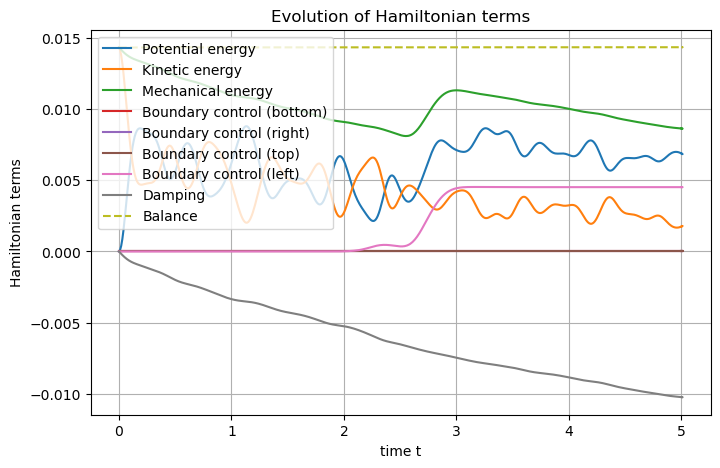

The wave equation — 2A: conservative anisotropic membrane
=========================================================

.. _Wave_2D:

.. automodule:: examples.wave
   :members:
   :undoc-members:
   :show-inheritance:

Why this example?
-----------------

The :doc:`first tutorial <../started>` showed a **one-dimensional**
string and its two boundary ports. Our next model is genuinely
**two-dimensional**, heterogeneous and anisotropic, with **mixed
boundary control**: three boundary segments prescribe an outward
normal traction, while the fourth prescribes a *velocity*. We will
keep exactly the same materials, mesh and boundary convention when
we add an internal dissipative port in example **2B**. We will
then study the complementary co-energy formulation in example
**2C** (:doc:`wave_coenergy`).

This page describes the actual code in ``examples/wave.py`.
Its snippets are included **directly from that file**, avoiding
manual discrepancies between the tutorial and the program.
The validated physical model is the same for all PETSc solver backends.
The sparse LU factorization may nevertheless require explicit
backend-specific options. The tested SuperLU_DIST configuration,
the ten algebraic zero diagonals and its native MPI validation
are explained in :doc:`../solver_saddle_points`.

The physical model
------------------

Let :math:`\Omega=(0,2)\times(0,1)` and let :math:`w(t,x,y)`
denote the transverse displacement of a membrane. We consider

.. math::

   \rho(x)\,\partial_{tt} w
   - \operatorname{div}(T(x,y)\nabla w)=0,

where the in-plane tension tensor and areal mass density are

.. math::

   T(x,y)=\begin{bmatrix}5+x&xy\\xy&2+y\end{bmatrix},
   \qquad \rho(x)=3-x.

Here :math:`T` is **not** a scalar Young modulus. It is a
symmetric, positive-definite anisotropic tensor; both :math:`T`
and :math:`\rho` vary spatially. The lower, right and upper
boundaries are :math:`\Gamma_N` (GetFEM regions 10, 11 and 12).
The left boundary is :math:`\Gamma_D` (region 13). Writing
:math:`n` for the **outward** unit normal, the controls are

.. math::

   n\cdot(T\nabla w)=u_N \quad\hbox{on }\Gamma_N,
   \qquad \partial_t w=u_D \quad\hbox{on }\Gamma_D.

The second condition prescribes *velocity*, **not** displacement.
This is sometimes called a velocity-Dirichlet port in the
port-Hamiltonian literature.

Energy variables, co-energy variables and power
-----------------------------------------------

We choose the energy states

.. math::

   q=\nabla w,\qquad p=\rho\,\partial_t w,

and their conjugate co-energies

.. math::

   e_q=Tq,\qquad e_p=p/\rho.

Thus :math:`q` and :math:`e_q` are **vectors**,
whereas :math:`p` and :math:`e_p` are **scalars**. The
first-order port-Hamiltonian dynamics are

.. math::

   \partial_t q=\nabla e_p,\qquad
   \partial_t p=\operatorname{div}e_q.

The physical Hamiltonian is

.. math::
   :label: wave_2d_conservative_energy

   \mathcal H(q,p)=\tfrac12\int_{\Omega}
   \left(q\cdot Tq+\frac{p^2}{\rho}\right)\,\mathrm dx.

In the **GetFEM Generic Weak Form Language** (GWFL),
``q.T.q`` denotes :math:`q\cdot Tq`: ``T`` is the
**tensor parameter's identifier**, not the transpose
operator from Python/NumPy. The actual code therefore
correctly uses ``"0.5*q.T.q"``.

With our boundary orientation, the collocated outputs are

.. math::

   y_N=e_p \quad\hbox{on }\Gamma_N,\qquad
   y_D=n\cdot e_q \quad\hbox{on }\Gamma_D.

The energy exchanged with the environment is

.. math::
   :label: wave_2d_conservative_power

   \frac{\mathrm d\mathcal H}{\mathrm dt}
   =\int_{\Gamma_N}u_N y_N\,\mathrm ds
    +\int_{\Gamma_D}u_D y_D\,\mathrm ds.

Our short demonstration uses **zero** Neumann tractions,
with a nontrivial prescribed left velocity. Thus the
left-hand boundary supplies the entire mechanical work;
the right, top and bottom boundary powers are zero.

From the strong equation to PFEM
--------------------------------

Integrating :math:`\partial_t p=\operatorname{div}e_q`
against a test function :math:`\varphi_p` gives

.. math::

   \int_\Omega\partial_t p\,\varphi_p
   =-\int_\Omega e_q\cdot\nabla\varphi_p
    +\int_{\Gamma_N}u_N\varphi_p
    +\int_{\Gamma_D}y_D\varphi_p.

The first equation is tested without integration by parts:

.. math::

   \int_\Omega\partial_t q\cdot\varphi_q
   =\int_\Omega\nabla e_p\cdot\varphi_q.

These two choices yield the partitioned finite-element
discretization (PFEM): ``DG1`` for vector strain
:math:`q`, ``CG2`` for scalar momentum :math:`p`,
and ``DG1`` boundary traces. The exact finite-element
spaces and material definitions are shown below.

In SCRIMP's assembly convention, the *flow-side*
algebraic variables for the Neumann velocity observations
are **``-Y_B``, ``-Y_R``, ``-Y_T``**, and the
velocity input on the left appears as **``-U_L``**.
The corresponding effort-side test terms are negative
velocity traces. The signs make the measured
powers consistent with :eq:`wave_2d_conservative_power`.
They have been checked by native GetFEM/PETSc simulations,
not merely assumed from the matrix layout.

Build the real SCRIMP model
---------------------------

To reproduce the snippets in a notebook, begin with these
imports and the *same tested defaults* (the command-line entry
point accepts other values):

.. code-block:: python

   import numpy as np
   import scrimp as S

   mesh_size = 0.2
   final_time = 0.08
   time_step = 0.008
   factor_solver = None  # Production default: MUMPS

The four boundary identifiers are taken directly from
the Python module, too:

.. literalinclude:: ../../../examples/wave.py
   :language: python
   :start-after: # TUTORIAL 2A-00:
   :end-before: def wave_eq(

The following seven sections are taken **literally** from
``examples/wave.py:wave_eq()``; no duplicate hand-written
Python excerpts are maintained in Sphinx. The boundary
index tuple ``BOUNDARIES`` is defined at module level.

**1. Instantiate the DPHS, domain, states and co-states.**

.. literalinclude:: ../../../examples/wave.py
   :language: python
   :start-after: # TUTORIAL 2A-01:
   :end-before: # TUTORIAL 2A-02:
   :dedent: 4

**2. Define the four mixed boundary ports.** Only the left port
uses ``position="flow"``, since it imposes the velocity
instead of the normal traction.

.. literalinclude:: ../../../examples/wave.py
   :language: python
   :start-after: # TUTORIAL 2A-02:
   :end-before: # TUTORIAL 2A-03:
   :dedent: 4

**3. Choose the PFEM spaces and material coefficients.**
GetFEM's nested GWFL matrix definition is symmetric and
represents the actual inhomogeneous tensor :math:`T`.

.. literalinclude:: ../../../examples/wave.py
   :language: python
   :start-after: # TUTORIAL 2A-03:
   :end-before: # TUTORIAL 2A-04:
   :dedent: 4

**4. Assemble the Dirac structure and constitutive laws.**
The rows with ``dt=True`` represent the differential
part of the port-Hamiltonian DAE. Boundary observations and
constraints are algebraic; the signs are visible here.

.. literalinclude:: ../../../examples/wave.py
   :language: python
   :start-after: # TUTORIAL 2A-04:
   :end-before: # TUTORIAL 2A-05:
   :dedent: 4

**5. Prescribe compatible initial data and controls.**
We set :math:`q_0=p_0=0`, so :math:`e_q=e_p=0`
at the initial instant, and apply

.. math::

   u_D(t,y)=0.2\sin(4\pi t)\sin(\pi y).

This input also vanishes at :math:`t=0` and at the
corners of the left boundary. It is already nonzero
during the ten-step installation smoke.

.. literalinclude:: ../../../examples/wave.py
   :language: python
   :start-after: # TUTORIAL 2A-05:
   :end-before: # TUTORIAL 2A-06:
   :dedent: 4

**6. Solve the actual DAE.** The ``algebraic`` initial
projection is strict and preserves the prescribed
differential data. For the quick installation check
we use fixed Crank--Nicolson,
:math:`t_f=0.08`, :math:`\Delta t=0.008`,
and ten accepted time steps, not a five-second
publication reproduction.

.. literalinclude:: ../../../examples/wave.py
   :language: python
   :start-after: # TUTORIAL 2A-06:
   :end-before: # TUTORIAL 2A-07:
   :dedent: 4

**7. Register the real anisotropic Hamiltonian.**
The two integrals are evaluated by GetFEM on the
actual finite-element fields.

.. literalinclude:: ../../../examples/wave.py
   :language: python
   :start-after: # TUTORIAL 2A-07:
   :end-before: # TUTORIAL 2A-08:
   :dedent: 4

To reproduce the complete program, use the canonical
entry point, which encapsulates the steps above
(and defines ``BOUNDARIES``):

.. code-block:: bash

   python -m examples.wave --solver mumps --check --export --output outputs/my_wave_2d

Installation and genuine scientific checks
------------------------------------------

The result must be a real **GetFEM/PETSc** solve, not an LU
factorization smoke. The common ``measure_wave_2d()``
function checks convergence, the strict initial DAE
projection, nonzero left power and the mechanical
energy/work equality **at every accepted CN step**:

.. math::

   \mathcal H(t_k)-\mathcal H(t_{k-1})
   -\Delta t_k\left(P_{B,k}+P_{R,k}+P_{T,k}+P_{L,k}\right)
   \simeq 0.

The port powers :math:`P_{\ast,k}` are the genuine
``cn_step`` GetFEM integrals sampled on the **mean FE
state** of the accepted step, not instantaneous endpoint
powers. Never trapezoid-integrate the ``P[0]`` sample.

The **initial MUMPS native pilot** passed in MPI 1
and MPI 2, with 2,230 DOFs, ten accepted steps and
numerical energy/power defects below
:math:`3\times10^{-18}`. Both ranks had identical
full trajectories; the MPI 1/MPI 2 state difference
was below :math:`4.2\times10^{-14}`. All four
fields (``q``, ``p``, ``e_q``, ``e_p``)
were exported as valid, root-only shared VTU/PVD,
with **11 time frames per field**. This is a
qualified **MUMPS MPI1/2** result only, not yet
a five-backend installation acceptance.

The complete installation acceptance requires:
MUMPS (MPI 1/2), sequential SuperLU (MPI 1),
and SuperLU_DIST (MPI 1/2). The three backends
must reproduce the same state, Hamiltonian,
physical powers, and ParaView outputs.
SuperLU standard is **serial-only**.

To save the four original GetFEM variable series,
open ``outputs/my_wave_2d/pv/q/q.pvd``,
``pv/p/p.pvd``, ``pv/e_q/e_q.pvd`` or
``pv/e_p/e_p.pvd`` in ParaView and play the
11 frames. The vector fields ``q`` and
``e_q`` may be displayed with arrows; the
velocity is ``e_p`` (not momentum ``p``).

**A future longer simulation** will supply richer
2D propagation maps, boundary work figures,
PNG/SVG plots and online animation. Keep the
short five-backend installation test separate
from expensive documentation rendering.
The displacement ``w`` is not an independent
variable of this energy-based DAE; do not label
the strain ``q`` as membrane deflection.
Any animation of ``w`` must identify its
reconstruction method and gauge.

Scientific references
---------------------

This introductory 2D example illustrates the
PFEM framework analyzed by **Haine, Matignon and
Serhani (2023)**, *Numerical Analysis of a
Structure-Preserving Space-Discretization for an
Anisotropic and Heterogeneous Boundary Controlled
N-Dimensional Wave Equation As a Port-Hamiltonian
System*, DOI `10.4208/ijnam2023-1005`, and
the mixed-boundary-control work of **Brugnoli,
Haine and Matignon (2022)**. The tutorial is
**not** a numerical reproduction of either paper.

The next section introduces a physically distinct
**resistive port** in ``examples/wave_dissipative.py`
while keeping the same material, domain and
conventions. The later :doc:`wave_coenergy`
chapter changes the state variables and adds
spatially localized damping.

2B — Adding damping to the DPHS
-------------------------------

.. automodule:: examples.wave_dissipative
   :members:
   :undoc-members:
   :show-inheritance:

The remining part of the notebook is focused on the way to deal with
*dissipativity*, hence using an **algebraic port**.

Let us come back to the continuous system. Adding a (fluid) damping
consists in an additive term in Newton second law, which is proportional
to the velocity (in the linear case). More precisely, denoting
:math:`\nu\ge0` the viscous parameter, one has:

.. math::

       \rho(x) \partial_{tt}^2 w(t,x) - {\rm div} \left( T(x) \cdot {\rm grad} \left( w(t,x) \right) \right) + \nu(x) \partial_t w(t,x) = 0.

Using the framework of port-Hamiltonian system, this rewrites:

.. math::

       \begin{pmatrix} \partial_t \alpha_q \\ \partial_t \alpha_p \end{pmatrix}
       =
       \begin{bmatrix} 0 & {\rm grad} \\ {\rm div} & 0 \end{bmatrix}
       \begin{pmatrix} e_q \\ e_p \end{pmatrix}
       +
       \begin{pmatrix} 0 \\ - \nu e_p \end{pmatrix}.

One could include :math:`-\nu` inside the matrix of operators, this is
the so-called :math:`J-R` framework. However, it does not exhibit the
underlying Dirac structure, as it hides the resistive port. Let us
introduce this hidden port, by denoting :math:`f_r` the flow and
:math:`e_r` the effort, as follows:

.. math::
    :label: with-diss

       \begin{pmatrix} \partial_t \alpha_q \\ \partial_t \alpha_p \\ f_r \end{pmatrix}
       =
       \begin{bmatrix} 0 & {\rm grad} & 0 \\ {\rm div} & 0 & -I \\ 0 & I^\top & 0 \end{bmatrix}
       \begin{pmatrix} e_q \\ e_p \\ e_r \end{pmatrix},

and supplemented by the resistive constitutive relation
:math:`e_r = \nu f_r`.

Of course, at the discrete level, this will increase the number of
degrees of freedom, as two extra variables have to be discretized.
Nevertheless, in more complicated situations (*e.g.* dealing with
non-linearities), this is the price to pay to recover a correct discrete
power balance.

The **power balance** satisfied by the **Hamiltonian** is then

.. math::

       \frac{\rm d}{{\rm d}t} \mathcal{H}(t) = \underbrace{-\int_\Omega \nu(x) f_r^2(t,x)}_{\text{dissipated power}} \underbrace{+ \left\langle y_N(t,\cdot), u_N(t,\cdot)\right\rangle_{\Gamma_N}}_{\text{power flowing through }\Gamma_N} \underbrace{+ \left\langle u_D(t,\cdot), y_D(t,\cdot) \right\rangle_{\Gamma_D}}_{\text{power flowing through }\Gamma_D},

Another simulation
------------------

Let us start a new simulation with damping.

.. code:: python

    # Define a new dphs
    wave_diss = S.DPHS("real")

    # Set the domain (using the built-in geometry `Rectangle`)
    # Labels: Omega = 1, Gamma_Bottom = 10, Gamma_Right = 11, Gamma_Top = 12, Gamma_Left = 13
    rectangle = S.Domain("Rectangle", {"L": 2.0, "l": 1.0, "h": 0.1})

    # On the rectangle domain
    wave_diss.set_domain(rectangle)

    # Define the variables
    states = [
        S.State("q", "Strain", "vector-field"),
        S.State("p", "Linear momentum", "scalar-field"),
    ]
    costates = [
        S.CoState("e_q", "Stress", states[0]),
        S.CoState("e_p", "Velocity", states[1]),
    ]

    # Add them to the dphs
    for (state,costate) in zip(states,costates):
        wave_diss.add_state(state)
        wave_diss.add_costate(costate)

    # Define the control ports
    control_ports = [
        S.Control_Port(
            "Boundary control (bottom)",
            "U_B",
            "Normal force",
            "Y_B",
            "Velocity trace",
            "scalar-field",
            region=10,
        ),
        S.Control_Port(
            "Boundary control (right)",
            "U_R",
            "Normal force",
            "Y_R",
            "Velocity trace",
            "scalar-field",
            region=11,
        ),
        S.Control_Port(
            "Boundary control (top)",
            "U_T",
            "Normal force",
            "Y_T",
            "Velocity trace",
            "scalar-field",
            region=12,
        ),
        S.Control_Port(
            "Boundary control (left)",
            "U_L",
            "Velocity trace",
            "Y_L",
            "Normal force",
            "scalar-field",
            region=13,
            position="flow",
        ),
    ]

    # Add them to the dphs
    for ctrl_port in control_ports:
        wave_diss.add_control_port(ctrl_port)

The additional port is defined, added to the system ``wave_diss`` and a
``FEM`` is attached to it. Remark that we use the previously defined
objects, *i.e.* we only append the ``FEM`` of the resistive port to the
list of previously defined ``FEM`` objects. We choose continuous
Galerkin of order 2, as the resistive effort is of :math:`p`-type.

.. code:: python

    # Define a dissipative port
    port_diss = S.Port("Damping", "f_r", "e_r", "scalar-field")

    # Add it to the dphs
    wave_diss.add_port(port_diss)

    # Define the Finite Elements Method of each port
    FEMs = [
        S.FEM(states[0].get_name(), 1, "DG"),
        S.FEM(states[1].get_name(), 2, "CG"),
        S.FEM(control_ports[0].get_name(), 1, "DG"),
        S.FEM(control_ports[1].get_name(), 1, "DG"),
        S.FEM(control_ports[2].get_name(), 1, "DG"),
        S.FEM(control_ports[3].get_name(), 1, "DG"),
        S.FEM("Damping", 2, "CG"),
    ]

    # Add all of them to the dphs
    for FEM in FEMs:
        wave_diss.add_FEM(FEM)

The parameter :math:`\nu` is obviously linked to the ``Damping`` port.
It can be heterogeneous, as for the other parameters.

.. code:: python

    # Define physical parameters
    parameters = [
        S.Parameter("T", "Young's modulus", "tensor-field", "[[5+x,x*y],[x*y,2+y]]", "q"),
        S.Parameter("rho", "Mass density", "scalar-field", "3-x", "p"),
        S.Parameter("nu", "viscosity", "scalar-field", "0.5*(2.0-x)", "Damping"),
    ]

    # Add them to the dphs
    for parameter in parameters:
        wave_diss.add_parameter(parameter)

Looking at :eq:`with-diss`, only 3 non-zero block matrices have to be
added to the list of the already constructed bricks, for the Dirac
structure part. And finally, 2 bricks are needed to discretize the resistive constitutive
relation.

.. code:: python

    # Define the pHs via `Brick` == non-zero block matrices == variational terms
    bricks = [
        ## Define the Dirac structure
        # Define the mass matrices from the left-hand side: the `flow` part of the Dirac structure
        S.Brick("M_q", "q.Test_q", [1], dt=True, position="flow"),
        S.Brick("M_p", "p*Test_p", [1], dt=True, position="flow"),
        S.Brick("M_Y_B", "Y_B*Test_Y_B", [10], position="flow"),
        S.Brick("M_Y_R", "Y_R*Test_Y_R", [11], position="flow"),
        S.Brick("M_Y_T", "Y_T*Test_Y_T", [12], position="flow"),
        # Mass matrix
        S.Brick("M_r", "f_r*Test_f_r", [1], position="flow"),
        # The Dirichlet term is applied via Lagrange multiplier == the colocated output
        S.Brick("M_Y_L", "U_L*Test_Y_L", [13], position="flow"),
        # Define the matrices from the right-hand side: the `effort` part of the Dirac structure
        S.Brick("D", "Grad(e_p).Test_q", [1], position="effort"),
        S.Brick("-D^T", "-e_q.Grad(Test_p)", [1], position="effort"),
        S.Brick("B_B", "U_B*Test_p", [10], position="effort"),
        S.Brick("B_R", "U_R*Test_p", [11], position="effort"),
        S.Brick("B_T", "U_T*Test_p", [12], position="effort"),
        # The "Identity" operator
        S.Brick("I_r", "e_r*Test_p", [1], position="effort"),
        # Minus its transpose
        S.Brick("-I_r^T", "-e_p*Test_f_r", [1], position="effort"),
        # The Dirichlet term is applied via Lagrange multiplier == the colocated output
        S.Brick("B_L", "Y_L*Test_p", [13], position="effort"),
        S.Brick("C_B", "-e_p*Test_Y_B", [10], position="effort"),
        S.Brick("C_R", "-e_p*Test_Y_R", [11], position="effort"),
        S.Brick("C_T", "-e_p*Test_Y_T", [12], position="effort"),
        S.Brick("C_L", "-e_p*Test_Y_L", [13], position="effort"),
        ## Define the constitutive relations
        # Hooke's law under implicit form `- M_e_q e_q + CR_q q = 0`
        S.Brick("-M_e_q", "-e_q.Test_e_q", [1]),
        S.Brick("CR_q", "q.T.Test_e_q", [1]),
        # Linear momentum definition under implicit form `- M_e_p e_p + CR_p p = 0`
        S.Brick("-M_e_p", "-e_p*Test_e_p", [1]),
        S.Brick("CR_p", "p/rho*Test_e_p", [1]),
        # Constitutive relation: linear viscous fluid damping `- M_e_r e_r + CR_r f_r = 0`
        S.Brick("-M_e_r", "-e_r*Test_e_r", [1]),
        S.Brick("CR_r", "nu*f_r*Test_e_r", [1]),
    ]

Again, we use the previsouly defined ``Brick`` objects, thus, the whole
system is constructed by adding all the bricks.

.. code:: python

    # Add all these `Bricks` to the dphs
    for brick in bricks:
        wave_diss.add_brick(brick)

The initialization and solve steps are identical to the previous
conservative case.

.. code:: python

    ## Initialize the problem
    # The controls expression, ordered as the control_ports
    t_f = 5.
    expressions = ["0.", "0.", "0.", f"0.1*sin(4.*t)*sin(4*pi*y)*exp(-10.*pow((0.5*{t_f}-t),2))"]

    # Add each expression to its control_port
    for control_port, expression in zip(control_ports, expressions):
        # Set the control functions: it automatically constructs the related `Brick`s such that `- M_u u + f(t) = 0`
        wave_diss.set_control(control_port.get_name(), expression)

    # Set the initial data
    q_0 = "[0., 0.]"
    wave_diss.set_initial_value("q", q_0)
    p_0 = "3**(-20*((x-0.5)*(x-0.5)+(y-0.5)*(y-0.5)))"
    wave_diss.set_initial_value("p", p_0)

    ## Solve in time
    # Define the time scheme
    wave_diss.set_time_scheme(ts_type="cn",
                              t_f=t_f,
                              dt_save=0.01,
                              )

    # Solve
    wave_diss.solve()

Now one can define and plot the Hamiltonian.

.. code:: python

    ## Post-processing
    # Set Hamiltonian's name
    wave_diss.hamiltonian.set_name("Mechanical energy")

    # Define each Hamiltonian Term (needed to overwrite the previously computed solution)
    terms = [
        S.Term("Potential energy", "0.5*q.T.q", [1]),
        S.Term("Kinetic energy", "0.5*p*p/rho", [1]),
    ]

    # Add them to the Hamiltonian
    for term in terms:
        wave_diss.hamiltonian.add_term(term)

    # Plot the Hamiltonian and save the output
    wave_diss.plot_Hamiltonian(save_figure=True, filename="Hamiltonian_Wave_2D_Dissipative.png")
    

